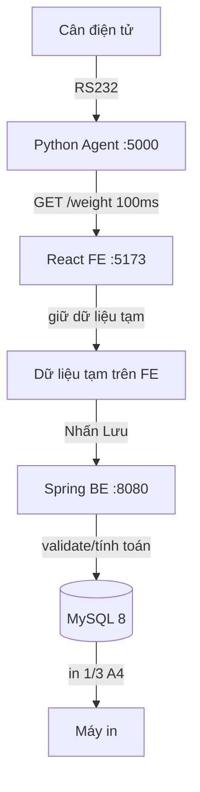

# Kiến Trúc Hệ Thống Trạm Cân

## Tổng quan

3 thành phần, mỗi thành phần 1 trách nhiệm:

| Thành phần | Nhiệm vụ |
|---|---|
| Python Agent (`scale_agent.py`) | Đọc cổng COM, expose `GET /weight` ở `127.0.0.1:5000` |
| React FE (`frontend-react`) | 1 màn hình `/tram-can`: hiện số cân realtime, giữ dữ liệu tạm, nhấn Lưu để gửi cả phiếu, in phiếu |
| Spring BE (`backend/vuong`) | Nhận `POST /api/tickets` (cả phiếu), validate/tính toán, lưu MySQL, trả mã phiếu |

## Luồng dữ liệu

**Giải thích luồng:**

1. **Cân → Agent**: Cân điện tử gửi dữ liệu qua RS232, Agent đọc và expose REST API tại `127.0.0.1:5000`.
2. **Agent → FE (realtime)**: FE poll `GET /weight` mỗi 100ms để hiển thị số cân realtime.
3. **FE giữ dữ liệu tạm**: Mỗi lần nhấn Space, FE ghi 1 lần cân vào state tạm (không gọi BE ngay). Dữ liệu tạm được lưu vào `localStorage` để không mất khi reload.
4. **Nhấn Lưu → BE**: Khi operator nhấn nút "Lưu phiếu", FE gửi **toàn bộ phiếu** (mảng records) lên BE 1 lần duy nhất.
5. **BE validate/tính toán → DB**: BE validate dữ liệu, tính tổng số bao/tổng cân, sinh `ticket_code`, lưu vào MySQL.
6. **In phiếu**: Sau khi lưu thành công, FE điều hướng sang trang in, lấy dữ liệu từ BE để in.

## Quyết định

| Hạng mục | Chốt |
|---|---|
| Vai trò Python | Đọc COM + expose REST localhost (FastAPI), React gọi |
| CSDL | MySQL 8 (giữ docker-compose, viết lại `db/init.sql`) |
| Phạm vi | 1 màn hình, không login, 1 loại hàng hoá |
| Đồng bộ "app chính" | Chưa có ở MVP |
| Cách lưu dữ liệu | FE giữ tạm → nhấn Lưu → BE nhận cả phiếu 1 lần (batch) |

## Rủi ro chính

| Rủi ro | Giảm thiểu |
|---|---|
| Cổng COM bị chiếm | `/health` trả `disconnected`, FE cho nhập tay |
| Cân báo `ST` nhưng vẫn nhảy số | FE chỉ cho ghi khi `stable == true` |
| Bấm Space 2 lần liên tiếp | FE debounce 500ms, BE validate trùng `weighSequence` |
| Mất điện giữa ca | FE lưu draft vào `localStorage` |
| Nhấn Lưu nhiều lần | BE trả `409` nếu `ticketUuid` đã tồn tại |
